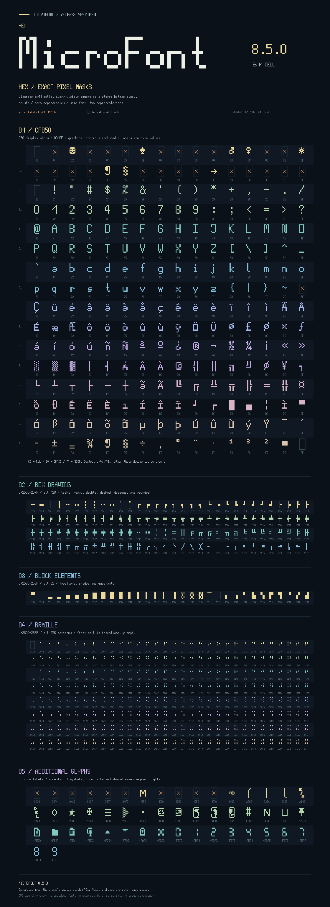
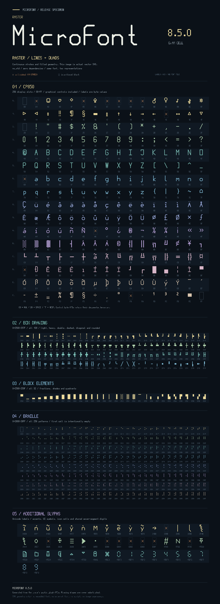

# MicroFont 8.5.0

Thank you to everyone building with MicroFont. Seeing it become part of your
projects is a big motivation to keep improving it.

One font, two representations: **6×11 bitmap masks** or **scalable line strips
and filled quads**. `no_std`, no runtime dependencies, no font engine, and no
allocation required by the readers or SVG writer. Choose either representation
or include both in one packed bundle.

**Hex bitmap use and the SVG stamper require no shaders.** GLSL shaders ship
with the crate as optional examples for people writing a **native GPU font
renderer** for the line and quad geometry. Software renderers can consume that
geometry directly too. See the [shader files and integration guide](shaders/README.md).

## Hex: exact pixels



[Open the full Hex SVG atlas](docs/atlas-hex.svg).
Every pixel above comes from the stored 66-bit masks.

## Raster: line and quad geometry



[Open the scalable Raster SVG atlas](docs/atlas-raster.svg).
This preview is real vector geometry: lines, dots and filled quadrilaterals
from the same records your renderer receives. It does not use an outline font
or trace the bitmap masks.

Both atlases show all 256 CP850 display slots, all 128 box-drawing characters,
all 32 block elements, all 256 braille patterns, and the additional stored
symbols. CP850 is **nearly complete**: 24 bitmap shapes and 11 raster shapes
are still unfinished, excluding intentional blank slots 00, 20 and FF.
Those gaps are marked in the previews. Box drawing, blocks and braille are
complete in both representations; U+2800 is an intentional blank.

Crates.io displays static README images; its [README renderer](https://github.com/rust-lang/crates.io/blob/main/crates/crates_io_markdown/src/lib.rs)
removes scripts and event handlers, so a type-to-preview control cannot run
inside this README. The
[Lattice glyph studio](docs/lattice-glyph-studio.html) is a standalone editor
that you can download and open locally.

## Features and embedded data size

Measured from this 8.5.0 source snapshot with the default glyph directory:

| Cargo features | Embedded `microfont.bin` | Included data |
| --- | ---: | --- |
| `hex` | **28,584 bytes** (27.91 KiB) | 66-bit bitmap masks |
| `raster` | **66,374 bytes** (64.82 KiB) | Line strips, quads, aliases and component recipes |
| `hex,raster` | **79,094 bytes** (77.24 KiB) | Both, with a shared index |
| `stamp` (default) | **28,584 bytes** (27.91 KiB) | Hex data plus caller-buffer stamping APIs |

These are exact **font payload sizes**, including the bundle index. They are
not the size of your executable or the Rust APIs: linked code depends on your
target, compiler, optimization and which functions you call. SVG/shader source
files are not embedded unless your application explicitly includes them.
Reproduce the measurements with `python3 tools/measure-bundles.py`.

Two illustrative **linked-code averages**, measured separately from font data:

| Workload | Average added code | Speed-optimized build | Size-optimized build |
| --- | ---: | ---: | ---: |
| Hex text stamping (`stamp`) | **2,040 bytes** (1.99 KiB) | 2,366 bytes | 1,714 bytes |
| Raster + SVG text output | **25,040 bytes** (24.45 KiB) | 29,258 bytes | 20,822 bytes |

Each average is the arithmetic mean of two release builds: `opt-level=3` and
`opt-level="z"`, using Rust 1.95.0 on `x86_64-unknown-linux-gnu`, fat LTO, one
codegen unit and aborting panics. The probes are `no_std`, use no allocator,
and keep inputs/output observable. Values are ELF `.text` bytes above the same
empty baseline; they exclude the font bundle, other read-only data, and ELF
headers. They are examples, not averages across all applications or targets.
The SVG figure includes Rust's number-formatting code; reading raw Raster
geometry does not require linking the SVG writer.

Reproduce both averages with
`python3 tools/measure-code.py --toolchain 1.95.0` (requires Cargo and GNU `size`).

```toml
# Original bitmap/stamping behavior (default features):
microfont = "8.5.0"

# Or select one representation explicitly:
# microfont = { version = "8.5.0", default-features = false, features = ["hex"] }
# microfont = { version = "8.5.0", default-features = false, features = ["raster"] }
# microfont = { version = "8.5.0", default-features = false, features = ["hex", "raster"] }
```

`stamp` enables `hex`; the SVG writer is available with `raster`. At least one
of `hex` or `raster` is required. Han and general Unicode text shaping are not
included.

## Put the geometry into your renderer

With `raster`, `raster_line::glyph_strips(ch)` borrows the line geometry and
`raster_quad::glyph_quads(ch)` borrows filled quads. Iterate each strip with
`iter_points()` to apply shared alias transforms correctly. Integer line
points identify pixel centers; quad vertices describe cell boundaries. End
and Junction tags remain available for your cap/join policy. Missing raster
records return `None`.

The dependency-free [`geometry_sink`](examples/geometry_sink.rs) example shows
how to consume these values as renderer primitives. The package includes
[portable GLSL vertex/fragment shaders and their vertex contract](shaders/README.md),
as well as the original TRUEOS mask shaders. Your application supplies the
software rasterizer or graphics API setup, vertex upload and blending; MicroFont
supplies the geometry. Shader files are shipped as source, not compiled for a
particular GPU.

These shaders are optional native GPU renderer examples, not a requirement of
the `raster` feature. Software rendering and SVG output do not use them.

```sh
cargo run --example geometry_sink --no-default-features --features raster
```

## SVG from `no_std`

The `svg` module writes the same raster geometry to a caller-provided
`core::fmt::Write` sink. The library needs neither `std` nor an allocator.
The host [`svg_text`](examples/svg_text.rs) example wraps those fragments in a
complete SVG document; the output can scale, recolor or rotate through ordinary
SVG transforms.

The SVG stamper requires no GPU or shaders. It writes SVG geometry; your chosen
SVG viewer or renderer handles displaying the result.

```sh
cargo run --example svg_text --no-default-features --features raster > sample.svg
```

```rust,no_run
# #[cfg(feature = "raster")]
# fn example() -> Result<(), microfont::svg::Error> {
let mut output = String::new(); // Or a fixed buffer / streaming fmt::Write sink.
microfont::svg::write_text(&mut output, "MicroFont 8.5.0", 0.8)?;
# Ok(())
# }
```

`write_glyph(&mut sink, character, stroke_width)` emits one source cell;
`write_text(&mut sink, text, stroke_width)` advances six units per cell.
Wrap fragments in an SVG element with its namespace and a suitable `viewBox`.
Paint uses `currentColor`; line caps and joins are round. Ordinary spaces are
blank advances, while control characters expand to their named labels. Missing
glyphs return `svg::Error::MissingGlyph` before writing the row.

This exports the stored font geometry; it does not provide a TTF parser, an SVG
rasterizer, automatic layout, shaping or a display driver.

## Bundle installation

The standard-library-only host build script packs the selected fields into one
uncompressed `microfont.bin`. Portable targets embed only that file and need no
runtime initialization, filesystem, tar reader or compression library. The host
build has no external packaging dependencies.

For `cfg(target_os = "trueos")`, the build script embeds one
`microfont.tar.lz4` archive instead and requires the host `lz4` command. TRUEOS
decompresses and installs the validated bundle before font output. Hex-only,
raster-only and combined selections all use the same format; compressed sizes
depend on the selected representation. `bundle::UNCOMPRESSED_BUNDLE_BYTES`
reports the selected uncompressed payload size.

## Reproduce the previews

```sh
cargo run --example atlas_previews --no-default-features --features hex,raster
```

The atlas generator uses this crate's public readers. SVG artifacts retain real
vector geometry; PNGs are static README fallbacks. See the example for output
paths and PNG conversion instructions.

## Editable source records

The existing `data/line-v1/` directory now holds version-2, mask-first records.
Its historical directory name is retained so glyph editing paths stay stable.
Each Unicode glyph is `uXXXX.bin` (uppercase hex, at least four digits). Private
components have descriptive filenames in their own subdirectories.

| Offset | Field |
| --- | --- |
| 0–15 | Little-endian `u128` bitmap; top-left pixel is bit 65, bottom-right bit 0 |
| 16 | Flags: bit 0 means a bitmap is present; all other bits are zero |
| 17 | Raster kind (below) |
| 18–19 | Reserved, zero |
| 20 onward | Raster payload, bounded by the file length |

A zero-valued bitmap can be a valid blank glyph. A clear presence flag means
that this record has no bitmap representation. Bitmap and raster fields are
independent; editing a bitmap does not change line or quad geometry.

| Kind | Payload |
| --- | --- |
| 0 | No raster data |
| 1 | Existing v1 line-strip records |
| 2 | Quads: four perimeter-ordered `[f32; 2]` corners, little endian, 32 bytes per quad |
| 3 | Shared alias: target ID `u32 LE`, then transform byte |
| 4 | Lowercase composition: base ID `u32 LE`, topper ID `u32 LE` (0 for none), omit-dot byte |
| 5 | Ordered list of shared line-component IDs, each `u32 LE` |
| 6 | Rounded box corner: orientation byte, then junction x/y, radius and stroke width as four `f32 LE` values |

Alias transforms are 1=mirror X, 2=mirror Y, 3=rotate 90°, 4=rotate 180°,
5=rotate 270°. Six private [lowercase toppers](data/line-v1/lowercase-toppers/README.md)
use IDs U+110000–U+110005. Seven-segment components use IDs 0x110100–0x110106.
These IDs are internal records, not Unicode characters or ordinary glyphs.

`homebutton.bin` is the line-only private start-button asset, ID `0x110200`.
Its 20-byte source header has a zero bitmap and presence flag zero, raster kind
1, then the original raw strip bytes. `raster_line::home_button_strips()` is its
named reader: it has no Unicode alias and does not enter either font atlas.
TRUEOS raster builds require this file and UI4 renders it independently once
at startup, with no replacement-glyph or section-sign fallback. Hex-only
bundles omit the asset.

A line-strip record starts with a header byte: bits 0–5 are point count minus
two, bit 6 marks an End at the start, and bit 7 marks an End at the finish.
Otherwise the boundary is a Junction. Each point occupies one byte: x in bits
0–2 (0–5), y in bits 3–6 (0–10); bit 7 is reserved. Two coincident points remain
a degenerate segment. Strokes retain their own boundary tags.

The build script validates selected records and their references. It discovers
new source records automatically; no Rust geometry generator is needed.

Rounded `╭ ╮ ╯ ╰` tiles each use two straight quads and a quarter-circle made
from 4–16 quads. The compact recipe uses orientation 0/1/2/3 respectively;
the initial junction is `(2.5,5.5)`, radius 2 and stroke width 1 source unit,
matching the adjoining `─` and `│` tiles. Bitmap fields remain independent.
`glyph_quads_at_size(character, em_height_px, em_10mm_px)` selects a budget:
the physical-size floor is four curve quads at 10mm, eight at 20mm and sixteen
at 40mm, with a sixteen-quad cap. A quarter-pixel outer-arc chord-error target
can increase the count on dense displays. If physical metrics are unavailable,
the same pixel-error target chooses the count with a minimum of four. The
default `glyph_quads` view uses four curve quads. All four orientations use the
same allocation-free recipe; no trig library or stored tessellation is needed.

## Runtime API

`glyph_cell_pixels(char)` returns the full bitmap; `glyph_pixels(char)` and
`font_pixels(u8)` retain the legacy 64-bit view. Bitmap APIs require `hex`.
Byte-to-character identities are unchanged, including the graphical CP850
control slots in `CP850_CHARACTERS`. Identity-only constants replace the old
bitmap-bearing `*_SYMBOLS` and `FPIXELS` tables.

With `stamp`, `stamp_text`, `stamp_bytes` and the ARGB variants write to caller
buffers. Controls and space can expand into named labels; keyboard/map icons
use private cells. `control_label_cells` returns a small owned mask view.
Unsupported Unicode uses the existing CP850 replacement cell.

With `raster`, `raster_line::glyph_strips` returns a borrowed `GlyphStrips` view.
Its iterator/get methods yield `Strip` values referencing the shared point
bytes. `raster_quad::glyph_quads` and the box/block/Braille helpers return quad
views with value iterators. `raster_quad::GLYPH_CHARACTERS` lists stored quad
glyphs, including `▬` and `■` outside the box/block ranges.
Raster-only builds contain no bitmap fields and
never reconstruct quads from hidden embedded masks.

The flat bundle layout and validation rules are documented in
[data/line-v1/README.md](data/line-v1/README.md).
